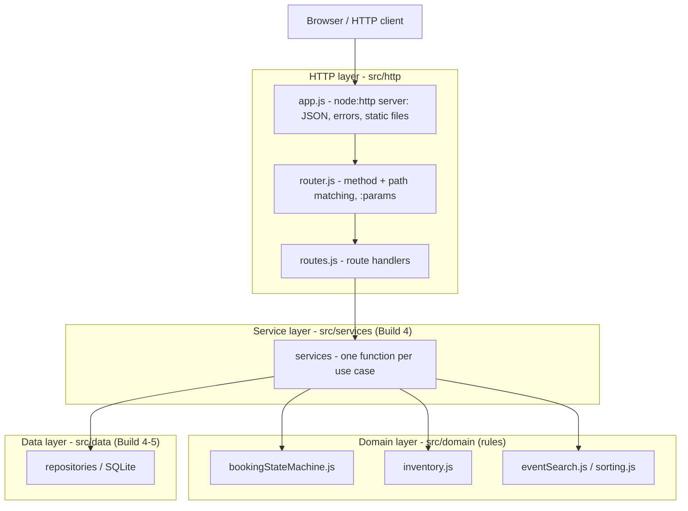
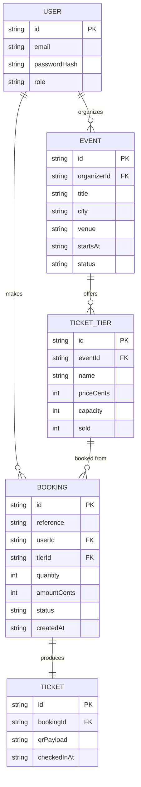
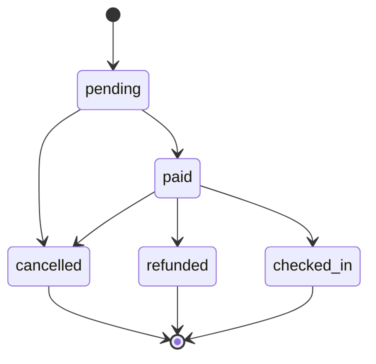

# Architecture: the Event Ticketing capstone

This is the shape of the whole project. We build it up one layer at a time.

## 1. The layers

A request travels down the left column and the answer travels back up. Nothing
calls upwards.



What each layer may and may not do:

- **HTTP layer (`src/http`)** may read the request, match a route, call a
  service and write the response as JSON or a static file. It may **not** hold
  any business rule, and it never talks to the database or the domain rules
  directly.
- **Service layer (`src/services`)** may run one use case end to end by
  coordinating the domain rules and the repositories, and it may throw
  `DomainError`s. It may **not** know about `req`/`res`, HTTP status codes or
  the browser.
- **Domain layer (`src/domain`)** may hold the pure rules: the booking state
  machine, the inventory and capacity rules, search and sorting. It may **not**
  do any I/O, and it knows nothing about HTTP or the database.
- **Data layer (`src/data`)** may read and write persistent storage (SQLite in
  Build 5). It may **not** contain business rules; it only stores and fetches.

In Build 3 only the HTTP layer, the domain layer and the entry point exist.
The service and data layers arrive in Build 4.

## 2. The data model



Money is always a whole number of the smallest unit (`priceCents`,
`amountCents`), never a decimal.

## 3. The booking life cycle



The same graph lives in code in `src/domain/bookingStateMachine.js`:

- allowed moves: `pending -> paid`, `pending -> cancelled`,
  `paid -> checked_in`, `paid -> refunded`, `paid -> cancelled`;
- `cancelled`, `refunded` and `checked_in` are final: nothing leaves them;
- every other move throws a `DomainError` with the code `INVALID_TRANSITION`.

## 4. Layer directory map

```
src/
  http/     request in, response out      (no business rules)
    app.js
    router.js
    routes.js
  services/ one function per use case      (Build 4)
  domain/   the pure rules                 (no I/O)
    bookingStateMachine.js
    inventory.js
    eventSearch.js
    sorting.js
    errors.js
    ids.js
    waitlistQueue.js
  data/     storage and repositories       (Build 4-5)
  config.js environment and defaults
  server.js the entry point
public/     static files served by app.js
```
