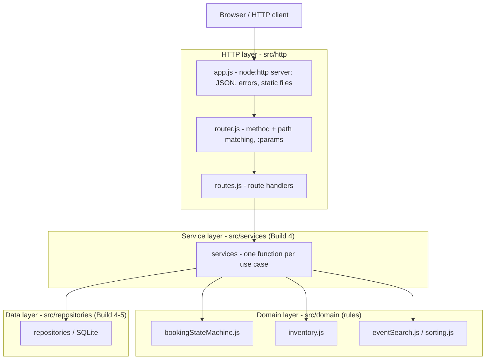
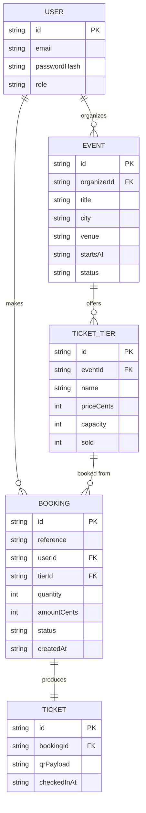
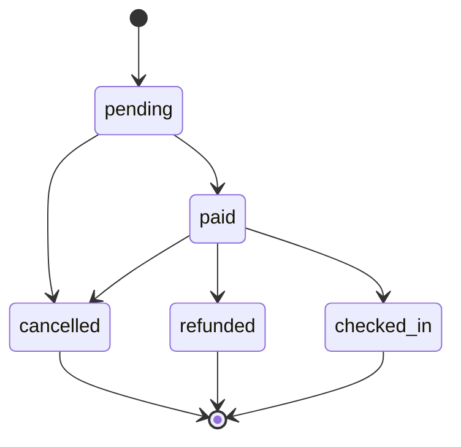

# Architecture: the Event Ticketing capstone

This is the shape of the whole project. We build it up one layer at a time.

## 1. The layers

A request travels down the left column and the answer travels back up. Nothing
calls upwards.



What each layer may and may not do:

- **HTTP layer (`src/http`)** may read the request, match a route, call a
  service and write the response as JSON or a static file. It may **not** hold
  any business rule, and it never talks to the database or the domain rules
  directly.
- **Service layer (`src/services`)** may run one use case end to end by
  coordinating the domain rules and the repositories, and it may throw
  `DomainError`s. It may **not** know about `req`/`res`, HTTP status codes or
  the browser.
- **Domain layer (`src/domain`)** may hold the pure rules: the booking state
  machine, the inventory and capacity rules, search and sorting. It may **not**
  do any I/O, and it knows nothing about HTTP or the database.
- **Data layer (`src/repositories`)** may read and write persistent storage. It
  may **not** contain business rules; it only stores and fetches. `memory.js`
  (Build 4) and `sqlite.js` (Build 5) expose the same async methods, so the
  services never learn where the data lives.

From Build 5 the data lives in SQLite (`src/db/`). One rule is enforced in the
database, not in JavaScript: seats are reserved with a single statement,

```sql
UPDATE ticket_tiers SET sold = sold + ? WHERE id = ? AND sold + ? <= capacity
```

and `CHECK (sold >= 0 AND sold <= capacity)` backstops it. Doing the check and
the write in one statement is what stops two callers from both winning the last
seat; a JavaScript check followed by a write has an `await` in between where the
other caller can slip through.

## 2. The data model



Money is always a whole number of the smallest unit (`priceCents`,
`amountCents`), never a decimal. In SQLite these are `INTEGER` columns,
`bookings.reference` is `UNIQUE`, every foreign key is declared (and enforced
with `PRAGMA foreign_keys = ON`), and `ticket_tiers.sold` carries the
`CHECK (sold >= 0 AND sold <= capacity)` guard.

## 3. The booking life cycle



The same graph lives in code in `src/domain/bookingStateMachine.js`:

- allowed moves: `pending -> paid`, `pending -> cancelled`,
  `paid -> checked_in`, `paid -> refunded`, `paid -> cancelled`;
- `cancelled`, `refunded` and `checked_in` are final: nothing leaves them;
- every other move throws a `DomainError` with the code `INVALID_TRANSITION`.

## 4. Layer directory map

```
src/
  http/     request in, response out      (no business rules)
    app.js
    router.js
    routes.js
  services/ one function per use case
    eventService.js
    bookingService.js
  domain/   the pure rules                 (no I/O)
    bookingStateMachine.js
    inventory.js
    eventSearch.js
    sorting.js
    validation.js
    errors.js
    ids.js
    waitlistQueue.js
  repositories/ storage and repositories
    memory.js
    sqlite.js
  db/       the SQLite schema and connection
    schema.sql
    connection.js
  lib/      helpers with no rules of their own
    mockPaymentGateway.js
  config.js environment and defaults
  server.js the entry point
public/     the browser app: static files served by app.js
  index.html  browse events (search, city, max price, sort)
  event.html  one event, its tiers and checkout
  css/
    styles.css
  js/         ES modules, no framework, no build step
    ui.js       tiny el()/format helpers (textContent only, never innerHTML)
    mockData.js fake events and tiers
    api.js      the ONE data access point the pages import
    pages/
      home.js
      event.js
```

## 5. The browser app (Build 6)

The screens run in the browser as plain ES modules and, for now, on fake data.
The rule that keeps Build 7 cheap: **the pages never call `fetch`.** They import
from `public/js/api.js`, whose functions resolve to the same shapes the real API
returns in `docs/api-examples.md`. Swapping the body of those functions for
`fetch` calls changes nothing on the pages.

- `public/js/api.js` also holds a copy of the search/filter/sort rules from
  `src/domain/eventSearch.js`, because the browser can only import from
  `public/`, not from `src/`. If those rules change, change both.
- A sold-out tier (`seatsLeft === 0`) is marked and its button is disabled.
- A quantity is clamped to at most 10 and at most the seats left
  (`clampQuantity` in `public/js/ui.js`).
- Checkout shows a countdown while the seats are held; a declined card shows an
  error and leaves the Pay button enabled to retry.
